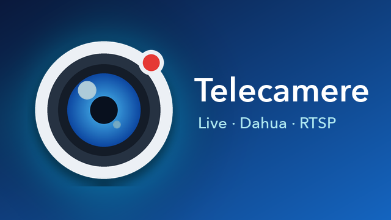

<p align="center">
  
</p>

<h1 align="center">Telecamere</h1>

<p align="center">
  Visualizzazione live di telecamere IP, NVR e videocitofoni Dahua su Android TV e Amazon Fire TV.<br>
  Sviluppata da <a href="https://www.pcwebagency.it">PC Web Agency</a>.
</p>

---

**Telecamere** è un'app per Android TV e Fire TV, leggera e pensata per il telecomando, che mostra in tempo reale le telecamere della rete locale o di sedi remote. Riconosce automaticamente i dispositivi Dahua (telecamere IP, NVR/XVR, videocitofoni) e accetta qualsiasi flusso RTSP standard.

> *English summary — Telecamere is a lightweight Android TV / Fire TV app to watch Dahua IP cameras, NVRs and video intercoms (plus any RTSP stream) live, with automatic network discovery, camera groups, remote-friendly controls and a door-open button for Dahua VTO intercoms.*

## Funzionalità

- **Ricerca automatica in rete** con il protocollo di discovery Dahua (DHIP), che riconosce modello e tipo (telecamera, NVR, videocitofono), più la scansione della porta RTSP per le telecamere di altre marche.
- **Import dei canali NVR**: dopo le credenziali vengono aggiunti tutti i canali con una telecamera collegata, con i loro nomi.
- **Aggiunta manuale** con IP o nome host (DDNS), porta, canale e URL RTSP personalizzato.
- **Griglia live 2×2** con pagine se le telecamere sono più di quattro, e **schermo intero HD** con audio.
- **Gruppi** (es. *Studio*, *Casa*): barra di selezione **Tutte · Studio · Casa** nella schermata live.
- **Qualità del flusso** per telecamera: *Standard* (flusso secondario in griglia, HD a schermo intero) o *Alta* (HD ovunque).
- **Apriporta per videocitofoni Dahua** (VTO): due serrature, con conferma.
- **Formato 16:9** fisso e centrato per tutte le telecamere.
- **Aggiornamenti dall'app**: controllo automatico delle nuove versioni pubblicate nelle Releases di GitHub e installazione con un clic (*≡ Menu → Informazioni e aggiornamenti*).
- **Riconnessione automatica** con watchdog. Con password errata i tentativi si diradano, per non bloccare l'account dell'NVR.
- Nessun account, nessun cloud, nessuna pubblicità: l'app comunica solo con le telecamere.

## Dispositivi supportati

| Tipo | Esempi | Note |
|---|---|---|
| Telecamere IP Dahua | IPC-HDW, IPC-HFW… | Flusso principale e secondario |
| NVR / XVR / DVR Dahua | NVR, XVR, HCVR | Import automatico dei canali (rete locale) |
| Videocitofoni Dahua | VTO2xxx, VTO3xxx | Video live + apriporta |
| Marchi OEM Dahua | Imou, Lorex, Amcrest… | Se espongono le API Dahua standard |
| Telecamere RTSP generiche | Qualsiasi marca | Tramite URL RTSP personalizzato |

I monitor interni dei videocitofoni (VTH) vengono riconosciuti ma non aggiunti, perché non hanno una telecamera.

## Requisiti

- Android TV o Fire TV con **Android 5.1** o superiore (Fire OS 5+).
- Telecamere raggiungibili in **RTSP** (porta 554 di default).

## Installazione

Scarica l'APK dalla pagina [Releases](../../releases).

### Con ADB (consigliato)

1. Sulla TV attiva le opzioni sviluppatore. Su Fire TV: *Impostazioni → La mia Fire TV → Informazioni*, premi 7 volte sul nome del dispositivo, poi *Opzioni sviluppatore → Debug ADB*.
2. Dal computer:
   ```bash
   adb connect IP_DELLA_TV:5555        # conferma "Consenti" sulla TV
   adb install -r Telecamere-1.0.0.apk
   ```

### Senza computer

Abilita *App da origini sconosciute* e installa l'APK con l'app **Downloader** o da una chiavetta USB.

### Aggiornamenti

L'app controlla da sola le nuove versioni e propone l'aggiornamento all'avvio. Il controllo si può fare anche a mano da *≡ Menu → Informazioni e aggiornamenti*. Al primo aggiornamento Android chiede di consentire a «Telecamere» l'installazione di app (Fire TV: *Opzioni sviluppatore → Installa app sconosciute*).

## Utilizzo

Al primo avvio premi **OK → Cerca in rete**, seleziona i dispositivi, scegli il gruppo e inserisci utente e password.

### Comandi del telecomando

| Schermata | Tasto | Azione |
|---|---|---|
| Griglia | Frecce | Seleziona la telecamera |
| Griglia | **OK** | Schermo intero |
| Griglia | **◀ ▶** ai bordi, **⏪ ⏩** | Pagina precedente / successiva |
| Griglia | **▲** dalla prima riga | Barra dei gruppi |
| Griglia | **⏯** o **OK tenuto premuto** | Apriporta (videocitofoni) |
| Schermo intero | **◀ ▶** | Telecamera precedente / successiva |
| Schermo intero | **OK** o **⏯** | Apriporta (videocitofoni) |
| Ovunque | **≡ Menu** | Impostazioni |

### Impostazioni di una telecamera

Nome, gruppo, IP o nome host, porta RTSP, utente, password, canale, URL RTSP personalizzato, porta HTTP, qualità del flusso e apriporta.

## Accesso da remoto

Per vedere le telecamere di un'altra sede, la TV deve raggiungere l'RTSP del dispositivo remoto. Le soluzioni sono due:

1. **VPN sito-sito** tra le due sedi (consigliata): i dispositivi remoti si aggiungono come se fossero in rete locale.
2. **Port forwarding** della porta **RTSP 554**, limitato all'IP pubblico della sede da cui si guarda. Per l'apriporta da remoto va inoltrata anche la porta **HTTP 80** del videocitofono.

> La porta **37777** usata dalle app Dahua (DMSS, SmartPSS) è un protocollo proprietario e **non** è supportata: serve la porta RTSP.

Esempio per router MikroTik:

```
/ip firewall nat add chain=dstnat in-interface-list=WAN protocol=tcp \
    src-address=IP_PUBBLICO_SEDE dst-port=47554 \
    action=dst-nat to-addresses=IP_LOCALE_NVR to-ports=554 \
    comment="RTSP NVR per app Telecamere"
```

Nell'app si indicano il nome host DDNS e la porta esterna (es. `47554`). L'import automatico dei canali NVR funziona solo in rete locale: da remoto i canali si aggiungono manualmente.

## Sicurezza e privacy

- Le credenziali sono salvate **solo sulla TV**, nella memoria privata dell'app. Non sono cifrate: usa un utente dedicato con permessi di sola visualizzazione dove possibile.
- L'app non usa servizi esterni, analytics o cloud.
- Con il port forwarding limita sempre l'accesso all'IP di origine e usa password robuste. Gli NVR Dahua bloccano l'account dopo ripetuti tentativi errati.

## Note tecniche

- Player: [AndroidX Media3](https://github.com/androidx/media) 1.4.1.
- Il modulo **RTSP di Media3** è incluso nei sorgenti, con due correzioni (dettagli in [NOTICE](NOTICE)):
  - risposte RTSP senza header `CSeq`, inviate da alcune telecamere economiche, che causavano il crash dell'app;
  - password contenenti `@`, che finivano nel nome host.
- Rendering su `TextureView`: i chip Amlogic di molte TV hanno un solo strato video hardware, che con più `SurfaceView` in griglia mostrerebbe una sola telecamera.
- Buffer ridotti per una latenza bassa sul live.

## Licenza

Distribuito con licenza **Apache 2.0**: vedi [LICENSE](LICENSE) e [NOTICE](NOTICE).

Dahua, Imou, Lorex, Amcrest, Amazon, Fire TV e Android sono marchi dei rispettivi proprietari. Questo progetto è indipendente e non è affiliato né approvato da essi.

## Autore

**PC Web Agency** — Ing. Carmine Palermo
[www.pcwebagency.it](https://www.pcwebagency.it) · info@pcwebagency.it

Sviluppo software, consulenza informatica e servizi web per aziende, enti e professionisti.
